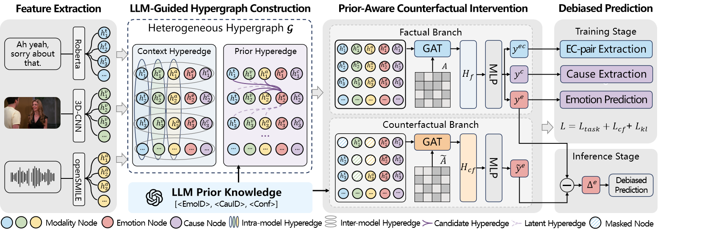

# CARE-HG

**Debiased Causal Reasoning Hypergraphs for Multimodal Emotion-Cause Pair Extraction in Conversations**

> CARE-HG models utterance-level relations with context and prior hypergraphs, then combines factual and counterfactual branches to predict emotions, causes, and emotion-cause pairs. At inference time, it debiases emotion scores by subtracting counterfactual logits from factual logits.

  

## 🛠️ Environment

~~~bash
conda create -n care-hg python=3.10 -y
conda activate care-hg

# PyTorch installation guide:
# https://pytorch.org/get-started/locally/

# DGL installation guide:
# https://www.dgl.ai/pages/start.html

pip install numpy scipy scikit-learn pyyaml tqdm wandb tensorboardX transformers
~~~

## 🚀 Training

Set the dataset and pretrained model paths in `config.yaml`.

~~~yaml
data_dir: data
data_name: ECF
network: MECPEC

textual_pretrain_model_dir: pretrained_models/textual/RoBERTa
audio_pretrain_model_dir: pretrained_models/audio/wav2vec2-base-960h
init_pretrain_checkpoint: pytorch_model.bin
output_dir: output

pretrain_encoder_type: RoBERTa
modality: [textual, audio]
use_llm: true

do_train: true
do_eval: false
seed: [67137]
num_train_epochs: 50
train_batch_size: 64
eval_batch_size: 64
learning_rate: 0.00005
gradient_accumulation_steps: 2
~~~

Save this configuration as `config.yaml`, then start training:

~~~bash
python run.py --config_file config.yaml
~~~

